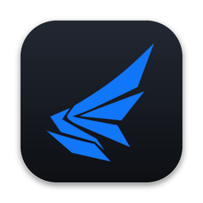

  

<h1 align="center">Shardwing</h1>

  Mission Planning für DCS World – vom Mission Editor bis ins Cockpit.
    
  <a href="https://github.com/Leichtester/shardwing-releases/releases/latest"><b>⬇ Neueste Version herunterladen</b></a>

 

Shardwing öffnet deine `.miz` und macht daraus ein Briefing-Paket, wie es eine echte Staffel nutzen würde. Routen, Cartridges, Lineup Card und taktische Grafiken plant ihr gemeinsam an einem Ort und spielt sie direkt zurück in DCS.

- **Cartridges (DTC)** für F-16C und F/A-18C: Steerpoints, Threats, Geo Lines, CMDS – natives `.dtc`, lädt im Jet wie aus dem Mission Editor
- **Briefing:** Lineup Card, Universals und Kneeboard-Seiten, fertig fürs Cockpit
- **Taktische Grafiken** wie CAP, Holding, FLOT oder Kill Box, als Zeichnungen in der Mission
- **Intel ohne God-View:** Jeder Flight sieht nur die Bedrohungen, die für ihn freigegeben sind
- **Gemeinsam planen:** Der Mission Designer teilt die Mission, Piloten melden sich per Link an und tragen ihre Daten selbst ein
- **Verlustfrei:** Shardwing ändert nur, was du bearbeitest – der Rest der Mission bleibt unangetastet

## Installation

| System | Datei |
|---|---|
| Windows 10/11 (x64) | `Shardwing_<version>_x64-setup.exe` |
| macOS 12+ (Apple Silicon) | `Shardwing_<version>_aarch64.dmg` |

Beides liegt beim [neuesten Release](https://github.com/Leichtester/shardwing-releases/releases/latest).

> [!NOTE]
> Die Installer sind noch nicht code-signiert, beim ersten Start warnt das System deshalb einmal:
> - **Windows:** Bei SmartScreen auf „Weitere Informationen“ → „Trotzdem ausführen“
> - **macOS:** Rechtsklick auf die App → „Öffnen“

## Updates

Shardwing sucht selbst nach neuen Versionen und bietet sie unten rechts an. Installiert wird erst nach deinem Klick; jedes Update ist signiert und wird vor der Installation geprüft.

---

Shardwing ist ein privates Projekt und steht in keiner Verbindung zu Eagle Dynamics. DCS World ist eine Marke von Eagle Dynamics SA. Der Quellcode liegt nicht in diesem Repository.
