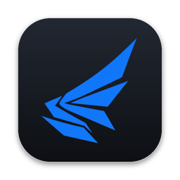

  

<h1 align="center">Shardwing</h1>

  <b>Mission Planning für DCS World – vom Mission Editor bis ins Cockpit.</b>
    
  <a href="https://github.com/Leichtester/shardwing-releases/releases/latest"> <b>Neueste Version herunterladen</b></a>
  &nbsp;&nbsp;·&nbsp;&nbsp;
  <a href="https://handbuch.shardwing.de/"> <b>Handbuch</b></a>

  

Shardwing öffnet deine `.miz` und macht daraus ein Briefing-Paket, wie es eine echte Staffel nutzen würde. Routen, Cartridges, Lineup Card und Timing plant ihr gemeinsam an einem Ort und spielt sie direkt zurück in DCS.

<table>
<tr><td width="50%" valign="top">&nbsp; <a href="https://handbuch.shardwing.de/bereiche/dtc"><b>Cartridges (DTC)</b></a>  Steerpoints, Threats, Geo Lines, Funk und CMDS für F-16C und F/A-18C – als natives <code>.dtc</code>, das im Jet lädt wie aus dem Mission Editor.</td><td width="50%" valign="top">&nbsp; <a href="https://handbuch.shardwing.de/bereiche/lineup-card"><b>Lineup Card & Kneeboards</b></a>  Lineup Card, Comm Card, Routenkarte, Attack Card, SPINS, Abnormals – fertig fürs Kneeboard, direkt in die Mission.</td></tr>
<tr><td width="50%" valign="top">&nbsp; <a href="https://handbuch.shardwing.de/bereiche/timing"><b>Timing</b></a>  H-Hour, TOT- und Vul-Fenster, Push, Tanker-Slots. Die Sync-Matrix zeigt, wer laut Route zu früh oder zu spät ist.</td><td width="50%" valign="top">&nbsp; <a href="https://handbuch.shardwing.de/bereiche/intel"><b>Intel ohne God-View</b></a>  Jeder Flight sieht nur die Bedrohungen, die für ihn freigegeben sind – auf Karte, Cartridge, Kneeboard und F10.</td></tr>
<tr><td width="50%" valign="top">&nbsp; <a href="https://handbuch.shardwing.de/gemeinsam/teilen"><b>Gemeinsam planen</b></a>  Der Mission Designer teilt die Mission, Piloten holen sich per Link einen Platz und planen ihren Flight selbst – live, im Browser.</td><td width="50%" valign="top">&nbsp; <a href="https://handbuch.shardwing.de/dcs/speichern"><b>Verlustfrei</b></a>  Shardwing ändert nur, was du bearbeitest. Trigger, Skripte, Mods – der Rest der Mission bleibt Byte für Byte, wie er war.</td></tr>
</table>

Dazu: Beladung pro Station, Attack Planner für Pop-up-, Toss- und Standoff-Angriffe, taktische Grafiken für F10 (CAP, FLOT, Kill Box …) und ein IADS-Werkzeug für das gegnerische Luftverteidigungsnetz.

  
  &nbsp;
  

## In drei Schritten

1. **Öffnen** – `.miz` ins Fenster ziehen.
2. **Planen** – Threats freigeben, für jeden Flight *Neu aus Route*, Joker und Bingo eintragen.
3. **Speichern** – Cartridges und Kneeboards stecken in der Mission. In DCS laden, fliegen.

Schritt für Schritt: [Die erste Mission in 5 Minuten](https://handbuch.shardwing.de/start/erste-mission)

## Installation

| System | Datei |
|---|---|
| Windows 10/11 (x64) | `Shardwing_<version>_x64-setup.exe` |
| macOS 12+ (Apple Silicon) | `Shardwing_<version>_aarch64.dmg` |

Beides liegt beim [neuesten Release](https://github.com/Leichtester/shardwing-releases/releases/latest).

> [!NOTE]
> Die Installer sind noch nicht code-signiert, beim ersten Start warnt das System deshalb einmal:
> - **Windows:** Bei SmartScreen auf „Weitere Informationen“ → „Trotzdem ausführen“
> - **macOS:** Rechtsklick auf die App → „Öffnen“

## Updates

Shardwing sucht selbst nach neuen Versionen und bietet sie unten rechts an. Installiert wird erst nach deinem Klick; jedes Update ist signiert und wird vor der Installation geprüft.

## Hilfe

Alles Weitere steht im **[Handbuch](https://handbuch.shardwing.de/)**: jeder Bereich im Detail, Abläufe für Mission Designer und Piloten, [Tastenkürzel](https://handbuch.shardwing.de/referenz/tastenkuerzel) und [Fragen & Probleme](https://handbuch.shardwing.de/referenz/faq).

---

## Nutzung

Shardwing ist kostenlos und darf von jedem für eigene Missionen genutzt werden – privat und in eurer Staffel. Es wird ohne Gewähr bereitgestellt. Teilt am besten den Link zu dieser Seite statt der Installer – dann bekommen alle die Updates. Die Lizenzen der enthaltenen Bibliotheken, Karten und Skripte stehen in der App unter *Menü → Lizenzen*.

---

[Impressum](https://handbuch.shardwing.de/rechtliches/impressum) · [Datenschutz](https://handbuch.shardwing.de/rechtliches/datenschutz) · [Lizenzen und Quellen](https://handbuch.shardwing.de/rechtliches/lizenzen) · Kontakt: kontakt@shardwing.de 
Shardwing ist ein privates, nicht kommerzielles Projekt und steht in keiner Verbindung zu Eagle Dynamics. DCS World ist eine Marke von Eagle Dynamics SA. Der Quellcode liegt nicht in diesem Repository.
